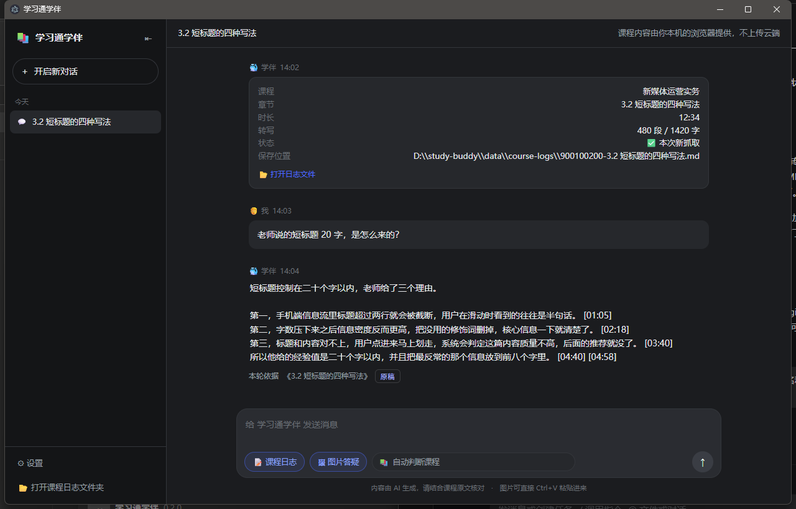
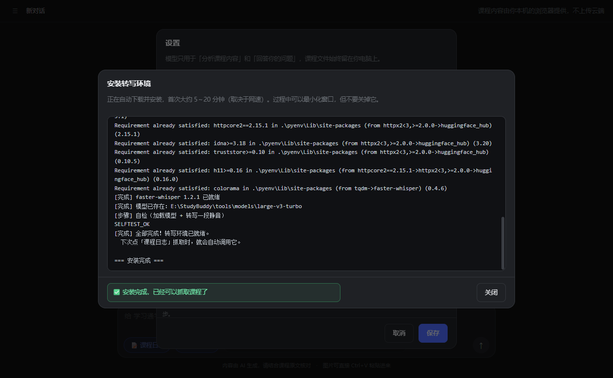
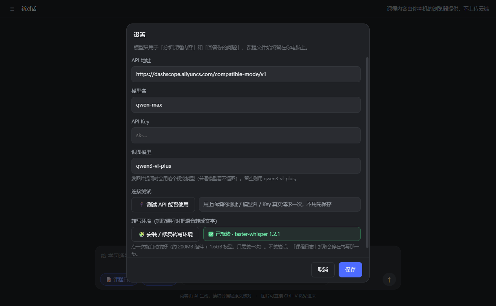
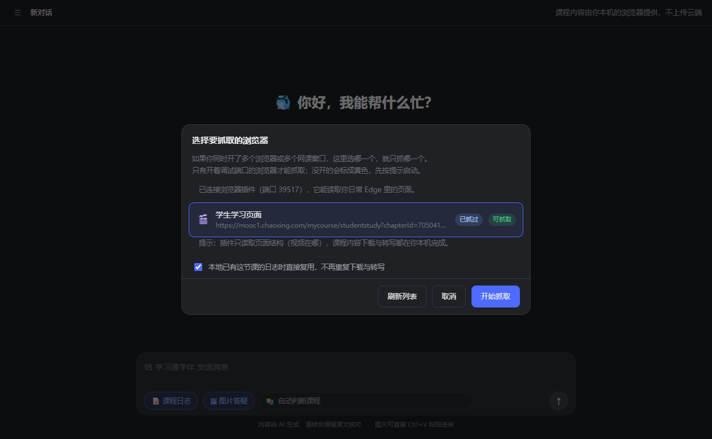
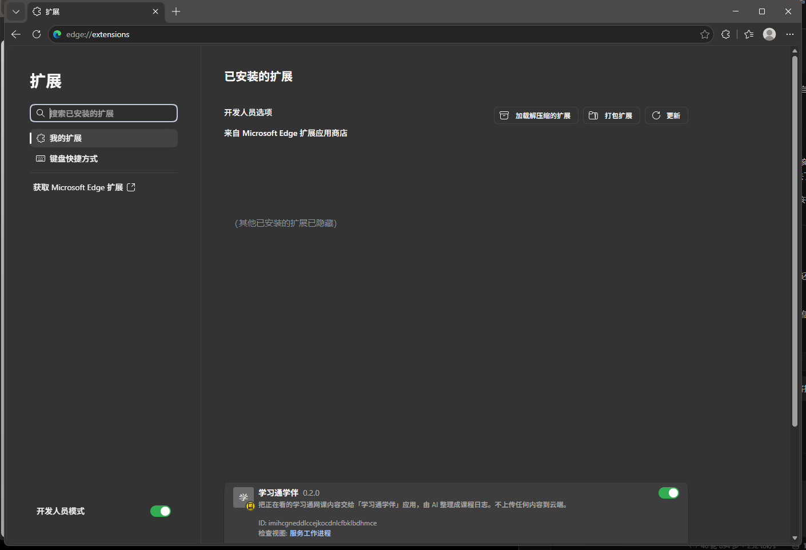

# 学习通学伴 · study-buddy

> 把学习通里的网课视频，变成可以搜索、可以提问的逐句文字稿。
> 课程内容由你本机的浏览器提供，应用不经过任何中转服务器。

一个跑在你自己电脑上的网课学习助手：用浏览器扩展从学习通播放页取出视频地址，下载到本机，用本地语音识别把整节课转成「[分:秒] 句子」格式的文字稿，再用 AI 帮你总结重点、回答疑问、讲解测验题。

不需要懂代码，跟着下面的步骤做就能用起来。

---

## 目录

- [它能做什么](#它能做什么)
- [只要防暂停？单独装这个小扩展](#只要防暂停单独装这个小扩展)
- [界面预览](#界面预览)
- [关于隐私：它会碰到哪些数据](#关于隐私它会碰到哪些数据)
- [安装（Windows，零基础）](#安装windows零基础)
- [一键播放答题](#一键播放答题)
- [开始使用](#开始使用)
- [常见问题](#常见问题)
- [目录结构](#目录结构)
- [技术原理](#技术原理)
- [免责声明](#免责声明)
- [License](#license)

---

## 它能做什么

| 功能 | 说明 |
| --- | --- |
| **抓取课程文字稿** | 在学习通播放页点一次按钮，自动下载视频并转成逐句文字稿（带 `[分:秒]` 时间戳） |
| **本地保存、不重复抓** | 每节课按 `chapterId` 存成一份 `.md`，抓过的课再点一次是「秒复用」，不重新下载 |
| **AI 总结** | 「这节课主要讲了什么」「分几条」，回答严格基于文字稿并标时间戳，方便回看核对 |
| **AI 答疑** | 跨课程检索：问哪节课都能找到对应日志，不会拿别的课的内容凑答案 |
| **识图答题** | 粘贴一张测验题截图，先识别图里的文字，再逐题对照课程内容给出答案和依据 |
| **指定课程** | 对话框下方可以锁定一节课程，之后所有回答只用这一节的内容 |
| **视频防暂停** | 页内小工具：鼠标离开播放器时尽量避免视频被暂停（可在页面上关闭） |
| **侧边栏收起** | 像 IDE 一样一键收起对话列表，给正文让出宽度（`Ctrl+B`） |

---

## 界面预览

抓取完一节课程之后，问什么它都只依据**这一节**的转写内容回答，每段后面带时间戳，点「原稿」能直接打开对应的转写文件：



> 这张图用的是虚构的演示课程（《新媒体运营实务》），不是任何真实课程内容。

主界面（对话 + 课程日志入口 + 指定课程选择）：



设置页（模型配置、一键测试、转写环境一键安装）：



选择要抓取的浏览器（会自动识别当前开着的学习通页面）：



在浏览器里加载扩展的样子（`edge://extensions`，左下「开发人员模式」打开后右上角会出现「加载解压缩的扩展」）：



> 图里只保留了「学习通学伴」这一项，其他扩展为了隐私做了遮挡。

---

## 只要防暂停？单独装这个小扩展

> **这里有两样东西，别搞混：**
>
> | | 完整应用 | 仅防暂停 |
> | --- | --- | --- |
> | 下载 | `study-buddy.zip`（652 KB） | `study-buddy-focus-only.zip`（4.8 KB） |
> | 解压后文件数 | **49 个** | **2 个** |
> | 加载哪个目录 | `<解压目录>\app\extension`（13 文件） | 解压根目录（2 文件） |
> | 扩展列表显示名 | **学习通学伴 0.6.3** | 学习通防暂停（专注模式）1.0.0 |
> | 页面角标 | 📚 学伴已就绪 + ▶ 一键播放答题 | 防暂停 |
>
> 完整版**已经自带防暂停**，不需要再装小扩展。两个同时装会出现两个角标。


如果你不需要 AI 总结和答疑，只是被「鼠标一离开播放框，视频就暂停」折磨，
那**不用装整套应用**。仓库里有一个独立的小扩展，专门干这一件事：

- 只有 2 个文件、约 11 KB
- **不申请任何权限**（`manifest.json` 里没有 `permissions`，也没有 `host_permissions`，不联网）
- 不需要 Node.js、不需要 Python、不需要 API Key、不需要主应用在跑

**下载安装（4 步）**

1. 到 [Releases](https://github.com/qeifb/study-buddy/releases/latest) 下载 `study-buddy-focus-only.zip`
2. 解压到任意文件夹（例如 `D:\study-buddy-focus`）
3. 打开 Edge，地址栏输入 `edge://extensions` → 打开「开发人员模式」→ 点「加载解压缩的扩展」→ 选刚解压出来的那个文件夹
4. 打开学习通任意播放页，**右上角出现「📚 防暂停 [守护中]」**就说明在工作

**它做了什么**

每 0.5 秒看一眼页面里的播放器；如果发现它被暂停了、而且已经停了超过 0.6 秒，
就调用一次 `play()` 把它续播起来。学习通会把「鼠标离开播放框」误判成「人离开了」，
这个扩展就是把这个误判撤销掉。

**想关掉**

点右上角那个「守护中」按钮 → 变成「已关闭」，这个页面就不再自动续播（刷新页面后恢复）。

> 说明：它和主应用里那个「视频防暂停」是同一份代码，只是把对主应用的依赖剥掉了。
> **如果页面上已经有完整版在跑**（它的 `#__studybuddy_badge` 角标在），这个小扩展会**自动让位**：
> 停止续播、把自己的角标收起来，不会重复干活。所以「先装它、后来又想用完整应用」也不会冲突。

---

## 关于隐私：它会碰到哪些数据

这是使用前最需要说清楚的一件事。

**课程内容从哪里来？**
从**你自己的浏览器**里来。扩展跑在你已登录的学习通页面上，只做两件事：读取当前页面的 `courseId / chapterId / 视频地址`，以及在你点击「抓取」时把这些信息交给本机的应用。

**课程内容会去哪里？**
1. 视频（`.mp4`）→ 下载到**你自己的硬盘**（`data/.tmp/`，转写完成后自动删除）
2. 文字稿（`.md`）→ 保存在**你自己的硬盘**（`data/course-logs/`）
3. 语音识别 → 在**你自己的 CPU** 上跑（faster-whisper），不使用任何云服务

**唯一会离开你电脑的东西**：你提问时，AI 需要读的那几段文字稿 + 你的问题，会**直接发送给你自己填写的那家 AI 服务商**（默认是阿里云百炼 DashScope）。没有中间服务器，应用不收集、不上传、不统计任何数据。

**不会离开你电脑的东西**：完整视频、完整文字稿、你的浏览器登录状态（Cookie / 密码）、你的课程列表。

> 如果你连「把几段文字发给 AI」也不希望，可以在设置里断网使用——那样只能做抓取和转写，不能问答。

---

## 安装（Windows，零基础）

> **不需要提前安装 Node.js、Python 或任何环境** —— 双击启动脚本会自动准备。

整个过程大约 **15 分钟**（不含模型下载时间）。建议装到 **非系统盘**（比如 `E:\study-buddy`），因为转写模型有 1.6GB。

### 第 1 步：不用装任何东西（Node.js 和 Python 都会自动准备）

**这一步什么都不用做。**

应用需要 Node.js 和 Python，但 `启动学习通学伴.cmd` 会**自动检查并准备两者**：

| 依赖 | 有就用 | 没有就 |
| --- | --- | --- |
| **Node.js** | 用你电脑里的 | 自动下载便携版（36MB） |
| **Python** | 用你电脑里的 | 自动下载便携版（44MB） |
| **项目依赖** | — | 自动 `npm install` |
| **Electron 运行时** | — | 自动下载（230MB） |

下载的便携版都**只解压到程序目录内**：

- `runtime\node\` — 便携版 Node.js
- `tools\python\` — 便携版 Python
- `tools\pyenv\` — 独立虚拟环境（不影响系统里其他 Python 项目）

**不装进系统、不写注册表、不需要管理员权限、不弹 UAC、不改 PATH。**

> 首次运行全过程约 **2~4 分钟**（Node 36MB + Electron 230MB）。
> 之后启动**只要 0.7 秒**（都复用本地）。

#### 关于语音模型（1.6GB）

转写需要下载语音识别模型，约 **1.6GB**。因为体积大，脚本会**问你一次**：

```
现在准备转写环境吗？输入 Y 回车=现在装，直接回车=跳过:
```

- 输入 **Y** → 下载 Python + faster-whisper + 模型（10~30 分钟）
- 直接**回车** → 跳过，应用仍能启动，之后可双击 `tools\setup-transcribe.ps1` 补装

> 不装转写环境的话，「抓课程日志 / 自动答题」会提示找不到环境，但应用其余功能正常。

#### 如果你更想自己装

**Node.js**：<https://nodejs.org/zh-cn> 下 LTS 版，装完**重启电脑**。
**Python**：<https://www.python.org/downloads/windows/> 下 3.10~3.13，装时勾选「Add python.exe to PATH」，装完**重启电脑**。

### 第 2 步：下载本项目

**方式 A（推荐）：从 Releases 下载打包好的压缩包**

1. 打开 <https://github.com/qeifb/study-buddy/releases/latest>
2. 在页面下方的 **Assets** 里点 **`study-buddy.zip`** 下载
3. 解压到一个**路径里没有中文、没有空格**的地方，例如 `E:\study-buddy`
4. 确认解压后能看到这三个文件夹：`app`、`tools`、`docs`

> Releases 页面每个版本的说明里都写了该版本 zip 的 SHA256，下载后可以按[官方地址与防伪](#官方地址与防伪)那一节的方法核对。

**方式 B：从仓库首页下载源码 ZIP**

1. 打开 <https://github.com/qeifb/study-buddy>
2. 点右上角绿色的 **Code** 按钮 → **Download ZIP**
3. 后面同上：解压到 `E:\study-buddy`

> 两种方式内容完全一样，都是源码，首次启动都会自动 `npm install`。区别只是 Releases 里的包带版本号和校验值，适合不想自己找按钮的人。

**方式 C（会用 git 的话）**

```bash
git clone https://github.com/qeifb/study-buddy.git E:\study-buddy
```

### 第 3 步：加载浏览器扩展

> ⚠️ **路径一定要选对，这是最容易出错的一步。**
>
> 解压 `study-buddy.zip` 后，**必须选**：
>
> ```
> <解压目录>\app\extension
> ```
>
> 选对后，`edge://extensions` 里应该出现 **「学习通学伴 0.6.3」**，
> 完整版解压后应能看到 **`app`、`tools`、`docs`、`README.md`** 这几项。
> 并且这个目录里应该有 **13 个文件**（能看到 `auto-pilot.js`、`pilot-core.js`、`font-table.js` 等）。
>
> 如果加载后显示的是 **「学习通防暂停（专注模式）1.0.0」**，说明选错了目录——那是另一个独立的小扩展。
>
> 📌 完整版 zip 已不再包含小扩展目录，所以正常解压后**看不到** `extension-focus-only` 文件夹。
> 如果你要用仅防暂停的小扩展，请单独下载 `study-buddy-focus-only.zip`。

1. 打开 Edge（或 Chrome）
2. 地址栏输入并回车：
   - Edge：`edge://extensions`
   - Chrome：`chrome://extensions`
3. 打开左下角（Chrome 是右上角）的 **开发人员模式 / Developer mode** 开关
4. 点 **加载解压缩的扩展 / Load unpacked**
5. 选择文件夹：`E:\study-buddy\app\extension`（**注意是 extension 这一层，不是 app 这一层**）
6. 看到列表里出现「学习通学伴」就成功了


> 关键是两处：左下角 **开发人员模式** 开关要打开，右上角才会出现 **加载解压缩的扩展** 按钮。图里其他扩展做了遮挡。

> 装完后，扩展图标可能不显示在工具栏。点地址栏右边的拼图图标 → 找到「学习通学伴」→ 点图钉固定。

### 第 4 步：启动应用

在项目根目录（`E:\study-buddy`）双击：

```
启动学习通学伴.cmd
```

首次运行会自动做三件事：装依赖（`npm install`）、下载 Electron 运行时（约 230MB，脚本里已把下载源指到国内镜像，通常 20 秒内完成）、**在桌面创建「学习通学伴」快捷方式**。整体约 1~3 分钟。之后每次直接双击桌面上的图标就能启动，不用再跑这个 cmd。

> 如果桌面上没出现快捷方式（比如你的桌面被 OneDrive 接管了），手动跑一次仓库根目录的 `create-shortcut.ps1` 即可：右键 →「使用 PowerShell 运行」。

也可以手动启动：

```bash
cd /d E:\study-buddy\app
npm install                             # 只有第一次需要
node node_modules\electron\install.js   # 必须！Electron 43 起不再自动下载运行时
npm start
```

> 从 Electron 43 开始，`npm install` 只装 JS 部分，**桌面运行时（那个 230MB 的 electron.exe）要显式跑一次 `node node_modules\electron\install.js`**。上面那个 cmd 已经帮你处理了，手动装的人才需要自己跑。

启动成功后会出现一个深色窗口，标题是「学习通学伴」。

### 第 5 步：填写 AI 的 API Key

应用本身不带 AI 能力，它只是把「课程文字稿 + 你的问题」发给你自己选的大模型服务商。默认支持阿里云百炼（新用户有免费额度，够测很久）。

#### 5.1 先申请一个 API Key（3 分钟）

1. 打开 <https://bailian.console.aliyun.com/> ，用**支付宝或淘宝账号**扫码/登录（不需要单独注册）
2. 如果是第一次进，页面会提示「开通百炼」，点一下开通（免费，不扣钱；按量计费从免费额度里扣）
3. 左侧菜单找到 **「API-KEY 管理」**（有的版本在「密钥管理」下）
4. 点 **「创建我的 API-KEY」** → 名称随便填（比如 `study-buddy`）→ 确定
5. 列表里出现一串 **`sk-` 开头**的字符，点「复制」——**这串东西只显示一次，先粘到记事本里存着**

> ⚠️ 这串 Key 等于你的钱包，**不要发给任何人、不要贴到群里或截图里**。本应用把它存在你自己电脑的 `data\settings.json`，不会上传。

#### 5.2 填进应用

回到应用窗口，点左下角 **⚙ 设置**，按下面这张表填：

| 字段 | 填什么 | 说明 |
| --- | --- | --- |
| API 地址 | `https://dashscope.aliyuncs.com/compatible-mode/v1` | 已经预填好了，一般不用改 |
| 模型名 | `qwen-plus` | 便宜够用；想答得更好填 `qwen-max`（贵一些） |
| API Key | 粘贴刚才复制的 `sk-...` | 粘贴后输入框会显示成圆点，正常现象 |
| 识图模型 | `qwen3-vl-plus` | 已预填，只有「图片答疑 / 讲题」才会用到 |

#### 5.3 点按钮测一下（这一步别跳过）

填完先别点保存，点 **🔌 测试 API 能否使用**：

- 出现绿色 **`✅ 可用 · 模型 qwen-plus · 800ms`** → 说明地址、模型名、Key 三者都对，点 **保存**
- 出现红色 `❌ 失败（HTTP 401）` → Key 复制少了几位或已失效，重新复制
- `HTTP 403` → 这个 Key 没开通该模型，去百炼控制台看模型是否已开通
- `HTTP 404` → 模型名写错，或 API 地址不是以 `/v1` 结尾
- `域名解析失败 / fetch failed` → 网络或代理问题，先确认能打开百炼控制台

> 也可以用别的服务：DeepSeek、智谱、Kimi、OpenRouter、本地 Ollama 都行，把「API 地址」和「模型名」换成对应服务的即可（只要它兼容 OpenAI 格式）。

### 第 6 步：转写环境（启动时已询问过，这里是补装入口）

语音识别需要一个 1.6GB 的模型。**启动脚本已经问过你要不要装**：

- 当时选了 **Y** → 已经装好了，这步跳过
- 当时**回车跳过** → 现在想用了，按下面补装

**补装方式（三选一）**：

| 方式 | 操作 |
| --- | --- |
| A. 双击脚本 | 双击 `tools\setup-transcribe.ps1`（右键 →「使用 PowerShell 运行」） |
| B. 应用内 | 打开 **⚙ 设置** → 找到「转写环境」→ 点「安装 / 修复转写环境」 |
| C. 命令行 | `powershell -ExecutionPolicy Bypass -File tools\setup-transcribe.ps1` |

**装的时候会自动完成**：检查/下载 Python（没有就下便携版 44MB）→ 建虚拟环境 → 装 `faster-whisper` → 下载模型 → 自检。

首次大约 **10~30 分钟**（主要等模型）。看到「全部完成！转写环境已就绪」就好了。

> **不需要你提前装 Python。** 系统有就用系统的，没有就自动下载便携版到 `tools\python\`。
>
> **模型下载失败怎么办**：脚本会自动换镜像重试（hf-mirror → 官方，各 2 轮）。
> 还失败可以换小模型：`.\setup-transcribe.ps1 -Model small`（1.6GB → 480MB）。
> 网络实在不行，看 [THIRD-PARTY.md](THIRD-PARTY.md) 里的手动下载说明。

---

## 一键播放答题

> 这个功能和上面的「读课程内容辅助学习」是两条独立的线。
> 它会在学习通页面上自动播放视频、自动做章节测验。
> **是否使用由你自己判断**，默认是关闭的，需要你手动点按钮开启。

### 它能做什么

1. **连续自动播放**：看完一节自动切下一节，中途卡住会尝试恢复。
2. **自动做视频弹题**：播放中弹出的选择题，按课程内容作答并提交，答错会换选项重试。
3. **自动做章节测验**：抓取本节课文字稿 → 按文字稿作答 → 自动勾选 → 自动提交（含「确认提交」弹窗）。
4. **严格先看后答**：进入章节先查任务点状态，视频没看完就先播，已看完直接答题——不会重复播放浪费时间。
5. **不做就不算分，所以绝不空着**：没有明确依据的题也会按上下文推断作答并标「（推测）」，留空等于 0 分。

### 怎么开

1. 打开学习通任意一节的播放页。
2. 页面右上角会出现「学伴已就绪」小条，**这个小条可以拖动**（双击复位），里面有「▶ 一键播放答题」按钮。
3. 点一下开始，再点一下停止。

### 字体混淆怎么处理

学习通章节测验页会给题目内联一个特殊字体，让页面文字显示正常但 DOM 里是乱码。
本项目用**确定性**方式还原，不是靠字形相似度猜：

```
glyphIndex = Typr.U.codeToGlyph(font, code)
path       = Typr.U.glyphToPath(font, glyphIndex)
hash       = md5(JSON.stringify(path)).slice(24)
真实汉字   = fontTable[hash]
```

同一个汉字的字形轮廓恒定，所以 MD5 也恒定，一张固定映射表就能 100% 精确还原。
实测真实题目字体 31/31 全部命中。映射表未命中时会自动回退到字形比对，并在界面标注低置信字。

详见 [THIRD-PARTY.md](THIRD-PARTY.md)。

---

## 开始使用

### 抓一节课的文字稿

1. 在浏览器里打开学习通的课程播放页（地址里带 `studentstudy` 的那种页面）
2. 开始播放视频（有的课需要点一下播放才会加载视频地址）
3. 回到应用，点输入框下方的 **📝 课程日志**
4. 弹窗里会列出当前开着的学习通页面，选中那一行（一般会自动选中）
5. 点 **开始抓取**
6. 等待：下载视频 → 语音识别 → 写入文字稿，界面会显示进度。一节 20 分钟的课大约 1~3 分钟
7. 完成后聊天里会出现一张卡片：课程名、时长、转写段数、保存位置，还有一个「打开日志文件」按钮

### 提问

直接在输入框里问就行，例如：

- 这节课主要讲了什么？分 8 条
- 老师提到的「五代计算机」是哪个国家搞的？为什么失败？
- 第 3 题为什么选 C？

回答会带 `[12:34]` 这样的时间戳，点回答下方的「原稿」按钮可以直接打开对应的文字稿核对。

### 锁定某一节课

输入框下方有一个下拉框，默认是「自动判断课程」。选成某一节课之后，AI 就只用那一节的内容回答，不会串课。

### 识图讲题

1. 用 `Win + Shift + S` 截一张测验题的图
2. 在应用里按 `Ctrl + V` 粘贴（或点 **🖼 图片答疑** 选择图片）
3. 输入「这 7 道题的答案是什么」后发送
4. 应用会先把图里的文字逐字识别出来，再对照课程内容逐题作答（约 30~60 秒）

> 图片建议截清晰一点、包含完整题干和选项。识别用的是视觉模型，模糊的图会认错字。

---

## 常见问题

**Q：双击 `启动学习通学伴.cmd` 后停在「正在下载 Electron 运行时」，或者报下载失败？**

那个 230MB 的 `electron.exe` 没下来。脚本已经默认把下载源指向国内镜像（npmmirror），但如果你开着代理、或者网络有额外限制，仍可能失败。手动重试：

```bash
cd /d E:\study-buddy\app\node_modules\electron
node install.js
```

还不行就关掉代理、换个网络再试。这一步只需成功一次，之后 `node_modules\electron\dist\electron.exe` 会一直存在（约 230MB）。

**Q：扩展图标上显示「未连接」，或应用里看不到浏览器页面？**
A：顺序反了。先启动应用（`启动学习通学伴.cmd`），再刷新学习通页面。扩展每 2 秒会向本机 `127.0.0.1:39517` 发一次心跳。

**Q：点「开始抓取」后立刻报「扩展没能读到页面」？**
A：多半是那个页面不是播放页，或者视频还没开始加载。确认地址里带 `studentstudy`、页面上有视频播放器。

**Q：卡在「正在转写」很久不动？**
A：转写是在本机 CPU 上跑的，一节 25 分钟的课大约 1~3 分钟。窗口底部会显示已转写的段数。如果超过 10 分钟没动静，检查设置页的「转写环境」是不是 ❌。

**Q：AI 回答的内容不对 / 有明显错误？**
A：文字稿是**语音识别**出来的，会有同音错字（比如「类脑」被听成「内脑」、「麦卡锡」被听成「McCartney」）。应用里已经要求 AI 只依据原文、标时间戳，但识别错误本身需要人工判断。拿不准的时候点「原稿」直接看文字稿。

**Q：页面上出现了好几个「学伴答疑」面板？**
A：旧版本遗留。在 `edge://extensions` 里点扩展的「重新加载」，然后刷新学习通页面即可。最新版本已限制只在顶层页面显示一个。

**Q：关闭窗口后应用还在后台？**
A：这是托盘常驻设计。点右下角托盘图标可以重新打开，右键菜单可以退出。关闭时弹窗里可以勾选「下次不再询问」。

**Q：换个盘符 / 换个目录还能用吗？**
A：可以。整个文件夹搬走后重新双击 `启动学习通学伴.cmd` 即可，数据目录跟着走（都在 `data\` 里）。

---

## 目录结构

```
study-buddy/
├── app/                     Electron 应用
│   ├── main.js              主进程：窗口、托盘、IPC、AI 调用编排
│   ├── preload.js           预加载：把安全的方法暴露给页面
│   ├── close-dialog.js      关闭确认窗口的桥
│   ├── core/
│   │   ├── ai.js            大模型调用（OpenAI 兼容 / 流式 / 识图）
│   │   ├── capture.js       抓取流水线：找视频 → 下载 → 转写 → 写 md
│   │   ├── lessons.js       课程日志的读写、按 chapterId 索引
│   │   ├── store.js         会话与消息存储
│   │   ├── extserver.js     本机 HTTP 服务（127.0.0.1:39517），和扩展通信
│   │   ├── launcher.js      启动带调试端口的浏览器（可选的抓取方式）
│   │   ├── browsers.js      发现本机浏览器与端口
│   │   ├── paths.js         数据目录探测（便携式，跟着程序走）
│   │   └── probe-dirs.js    启动自检
│   ├── extension/           浏览器扩展（Manifest V3）
│   │   ├── manifest.json
│   │   ├── background.js    Service Worker：代发本机请求、执行抓取任务
│   │   ├── content.js       页内角标（可拖动）+「一键播放答题」按钮挂载点
│   │   ├── focus-mode.js    防暂停（可选）
│   │   ├── ask-panel.js     页内「学伴答疑」面板（默认不加载）
│   │   ├── cand-chars.js    候选汉字表（解混淆的回退路径）
│   │   ├── pilot-core.js    一键播放答题：取数、字体解码、接口调用
│   │   ├── auto-pilot.js    一键播放答题：状态机主流程
│   │   ├── typr-lite.js     字体解析（Typr.js，MIT，见 THIRD-PARTY.md）
│   │   ├── md5-mini.js      MD5（blueimp-md5，MIT，见 THIRD-PARTY.md）
│   │   ├── font-table.js    字体映射表（字形 MD5 → 汉字，见 THIRD-PARTY.md）
│   │   └── popup.html/js    工具栏弹窗：连接状态
│   ├── renderer/            界面（原生 HTML/CSS/JS，无框架）
│   └── assets/              图标
├── tools/
│   ├── transcribe.py        语音识别脚本（faster-whisper）
│   ├── setup-transcribe.ps1 一键安装转写环境（会自动装便携版 Python）
│   ├── build-font-table.mjs 生成字体映射表（题库解码用）
│   └── check-extension.mjs  扩展合规自检
├── docs/screenshots/        文档截图
├── 启动学习通学伴.cmd
└── LICENSE
```

**运行时会自动生成**（不进版本库）：

```
data/
├── settings.json        模型配置（含你的 API Key，注意别外传）
├── chats.json           对话记录
├── course-logs/         课程文字稿（.md，带 [分:秒] 时间戳）
└── app.log              运行日志（超过 1MB 自动轮转）
runtime/                 便携版 Node.js 与各类缓存（自动下载）
tools/python/            便携版 Python（系统没装时自动下载）
tools/pyenv/             Python 虚拟环境
tools/models/            语音识别模型（1.6GB）
```

---

## 技术原理

给想改代码的人看的几句话。

1. **扩展取视频地址**：在学习通播放页里，视频通常在 `ananas/modules/video/index.html` 这个 iframe 里。扩展用 `chrome.scripting.executeScript({allFrames:true})` 遍历所有 frame，找到带 `src` 的 `<video>`，把地址和 `courseId / chapterId / 章节名` 交给本机应用。
2. **本机 HTTP 通信**：应用在 `127.0.0.1:39517` 起一个极小的 HTTP 服务，扩展每 2 秒轮询拿任务、回报结果（不依赖 WebSocket，因为 MV3 的 Service Worker 会休眠）。
3. **下载**：视频地址在 CDN 上，需要用播放页的 `Referer` 才能下，应用会带上。
4. **转写**：`faster-whisper`（large-v3-turbo，int8 量化）在本机 CPU 上跑，输出 `[分:秒] 句子` 后拼成 markdown。**不调用任何云转写服务。**
5. **上下文选择**：提问时按 `chapterId` 精确匹配课程日志；匹配不到会明确说「这节课还没抓过」，不会拿别的课凑答案。多轮对话会记住上一轮用了哪篇，避免追问时漂移。
6. **识图**：先用视觉模型把图里的**文字**逐字抄出来，去掉选项行后按关键词在本课文字稿里检索原文片段，再交给文字模型作答——比让视觉模型「边看边答」准得多。

---

## 官方地址与防伪

**唯一官方仓库**：`https://github.com/qeifb/study-buddy`

本项目用 MIT 协议开源，任何人都可以下载、修改、**在自己账号下**发布自己的版本。这一点需要说明清楚：

- 别人 fork 之后改了代码，**只会出现在他自己的仓库里**（`github.com/他的用户名/study-buddy`），**不会**出现在本仓库，也**不会**出现在本仓库的 Release 下载页里。
- 别人想把自己的改动合进本仓库，只能提交 Pull Request，**由仓库所有者审核后才会合并**。所以这里的代码和下载附件只有仓库所有者能更新。
- 真正的风险是「有人另建一个**同名**仓库或网盘链接冒充本项目的下载地址」。所以下载前请核对三件事：
  1. 地址栏里是 `github.com/qeifb/study-buddy`（注意用户名不要看错）
  2. 安装包来自本仓库右侧的 **Releases** 页面
  3. 附件与下方公布的 SHA256 一致

校验方法（Windows 自带命令）：

```cmd
certutil -hashfile study-buddy.zip SHA256
```

输出的那串十六进制，和 Releases 页面里写的必须完全一样。不一致就说明文件被改过，不要运行。

---

## 免责声明

- 本项目仅供**个人学习辅助**使用，请遵守你所在学校/平台的使用条款。
- 抓取与转写的是你自己已登录、已有权限观看的课程内容，代码不会绕过任何付费墙或权限校验。
- 请勿将转写稿二次分发（课程内容版权归授课教师与平台所有）。
- 使用本项目产生的一切后果（包括但不限于账号风险、版权争议）由使用者自行承担。

---

## License

[MIT](LICENSE)
